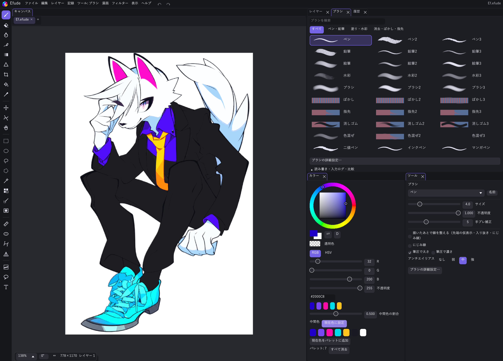

<p align="center">
  
</p>

<h1 align="center">Efude-neo</h1>

<p align="center">
  <b>An open-source painting and manga app for Windows, written in Rust.</b>
</p>

<p align="center">
  <a href="https://github.com/AiWithYou/Efude-neo/releases/latest"><b>Download</b></a> ·
  <a href="docs/USER_GUIDE.md">User Guide</a> ·
  <a href="CHANGELOG.md">Release history (Japanese)</a> ·
  <a href="README.md">日本語</a>
</p>

Efude-neo is a fork of [Efude by 852wa](https://github.com/852wa/Efude), with pressure-sensitive brushes, layer editing and manga tools. We thank the original project's author and contributors.



> **Public test.** The app is under active development. Files and settings may change between versions — keep backups of important work.

## Download and launch

**Requires Windows 10 or 11 (64-bit).** Pen tablets work through Windows Ink or WinTab.

Open the [Efude-neo download page](https://github.com/AiWithYou/Efude-neo/releases/latest) and choose one of these files:

| Download | How to launch |
| --- | --- |
| `Efude-v<version>-windows-x64.zip` (portable) | Extract it anywhere and run `efude.exe`. No installer is needed. |
| `Efude-v<version>-windows-x64.msi` (installer) | Open it and follow the setup wizard. |

Unsigned builds may trigger Windows SmartScreen on first launch. Check that the file came from this repository's release page, then use **More info → Run anyway** to launch it.

The original Efude has separate releases. Use the link above to download **Efude-neo**.

## Start a drawing

The interface starts in Japanese. Select **English** from the **ヘルプ (Help)** menu to switch languages.

1. Use **File → New…** (Ctrl+N), choose the canvas dimensions and create the canvas.
2. Choose a brush in the **Brush** panel, set the colour in **Color** and the size in **Tool**, then draw on the canvas.
3. Press **Ctrl+S** to save an `.efude` document. On the first save, choose its location and name.
4. To share an image, use **File → Export…** and choose PNG or JPEG.

The `.efude` format keeps layers and Efude-specific document settings for later editing. Keep this document after exporting an image. PNG preserves transparency; JPEG uses a white background. Layered PSD is available for exchanging work with other apps, but does not preserve every Efude-specific setting.

Common controls with the default shortcuts:

| Action | Control |
| --- | --- |
| Undo / redo | Ctrl+Z / Ctrl+Y or Ctrl+Shift+Z |
| Zoom | Mouse wheel |
| Pan the canvas | Hold Space and drag |
| Fit the canvas to the view | Ctrl+0 |

See the [User Guide](docs/USER_GUIDE.md) and in-app Help for detailed steps and shortcuts.

## Features

Draw with pressure-sensitive pens, pencils and watercolours, stroke stabilization and colour mixing. Build up artwork with raster and vector layers, 14 blend modes, masks, rulers and symmetry rulers. Manga tools include panels, screentones, focus and speed lines, vertical text in speech balloons and batch PNG export for multi-page books. You can also open PNG, JPEG, BMP, GIF and PSD files and paint over them.

## Differences from original Efude

These additions and improvements cover the changes from the original Efude 0.1.0 (`fe7c6f7`) through Efude-neo 0.4.0.

| Task | What changed in Efude-neo |
| --- | --- |
| Pick a colour | Choose hue on the outer ring and saturation and brightness in the inner square. Switch between RGB and HSV or enter a `#RRGGBB` value. Press `X` to swap the foreground and background swatches or `D` to reset them to black and white. The last 16 colours retain RGB independently of opacity. |
| Find a brush and vary its marks | Search by name or filter by category. Vary hue, saturation and brightness within a stroke, or turn the brush tip to follow the direction of the line. |
| Recolour without losing soft edges | Alpha lock preserves raster pixel opacity with CPU and GPU brushes, shapes, gradients, pastes, fills and filters. It blocks erasing, moving and transforming. Layer colour tints the artwork while preserving its original pixels. The tint appears in both CPU and GPU views and in PNG, JPEG and PSD exports. |
| Organize layers | Merge down (`Ctrl+E`), merge a folder, or copy the visible artwork to a new layer. Merges that could change the appearance prompt for confirmation, and editable balloons and panels are protected. Make a selection from opacity, including a folder’s contents. The toolbar stays above the scrolling list, thumbnails show tints and tones, and a right-click opens layer actions. Deleting all layers requires confirmation. |
| Draw shapes and gradients | Draw rectangles, rounded rectangles, ellipses, polygons and straight lines. Gradients can be linear, radial or reflected. |
| Crop and reshape | Crop to a dragged rectangle or to the selection bounds. Trimming transparent margins accounts for visible vector strokes. Balloons and their tails move with the crop. Cropping is disabled on manga pages with page settings to protect their layout. Drag the free-transform frame or the control points of a 4×4 mesh directly on the canvas. |
| Work on the canvas | The cursor shows brush diameter. Resize with `Ctrl+Alt+drag`, sample with `Alt+drag` and compare colours in the ring, or `Shift+click` to draw a straight line from the last endpoint. Rotate the view with `R+drag` and flip it horizontally with `H`. Read zoom and coordinates on the bottom status bar or click an action in History to return to that point. Canvas and paste previews adapt to display limits on documents up to 30,000 px per side. |
| Adjust colour and outlines | Seven additional filters cover Invert, Luminance to Opacity, Posterize, Threshold, Colour Balance, Gradient Map (with presets) and Outline. |
| Open and recover documents | PSD import handles masks and merged images more accurately. The app checks the ZIP or ZIP64 structure before loading an `.efude` document. Edited tabs get automatic recovery snapshots, even before their first save. |

### Guides, finishing checks and recording

- **Tracing guide** — Use **View → Tracing guide** to place an image below the drawing layers and adjust its opacity, position and scale. It is saved in the document and excluded from normal PNG, JPEG and PSD exports.
- **Finishing check** — Use **Edit → Finishing check…** to highlight transparent holes, isolated dots and artwork outside the finish area. It does not change the pixels; click a candidate to inspect it more closely.
- **Timelapse** — Use **Record → Start timelapse recording…** to capture the drawing process and export MP4 or MJPEG AVI. Choose whether to include the tracing guide before recording. MP4 export lets you set the total duration, final-image hold, video dimensions and fit mode.
- **Macros** — Record layer creation, duplication, naming, visibility, opacity and blend modes, edit their targets and steps, and replay them in another document. Replay is a single Undo step. Brush strokes and screen interactions are not recorded.

**MP4 export needs a separately installed FFmpeg build with `libx264`.** Select its executable in the export dialog or use FFmpeg on PATH. AVI export needs no FFmpeg. See the [User Guide](docs/USER_GUIDE.md#tracing-guide-timelapse-and-macros) for details.

<details>
<summary>Recording details and data locations</summary>

- MP4 duration is 1–600 seconds, including the final-image hold. Both MP4 and MJPEG AVI use 30 fps.
- JPEG frames remain after recording ends. Use **Record → Export video from previous recording…** to reuse them. If AVI exceeds 1.9 GB, use the JPEG frames instead.
- Macros saved in 0.3, including old macros you edit and save, cannot be read by 0.2. Old macros can still be opened in 0.3. Use **Save as another macro** to keep an old file for 0.2.

| Data | Location |
| --- | --- |
| Timelapse JPEG frames | `%LOCALAPPDATA%\Efude-neo\timelapse\` |
| Crash-recovery snapshots | `%LOCALAPPDATA%\Efude-neo\recovery\` |
| Macros | `%APPDATA%\Efude-neo\macros\` |

</details>

## Backups and recovery

Saved documents can be backed up periodically to a `.efude-backups` folder beside the document. Set the interval and number of generations in **File → Preferences…**.

Each changed tab, including an unsaved canvas, also gets a periodic recovery snapshot. After an unexpected exit, or through **File → Recover work…**, choose a thumbnail to restore it as a new, unsaved tab. The original document is not overwritten; save the restored work under a new name. A normal exit removes the current session's recovery snapshots.

## Help, changes and bug reports

- [User Guide](docs/USER_GUIDE.md): detailed instructions for each feature.
- [Release history](CHANGELOG.md): additions and fixes by version, in Japanese.
- [Bug reports and feature requests](https://github.com/AiWithYou/Efude-neo/issues): include the app version, Windows version, input method and steps to reproduce a problem.

## Build from source

<details>
<summary>Developer instructions and documentation</summary>

Requires Rust 1.95 or later. Run this from the repository root:

```powershell
cargo run -p efude-app --release
```

The workspace contains engine crates, the `efude` library, and the application (`efude-ui`, `efude-app`). File formats are described in [docs/spec](docs/spec). For release builds, see [docs/RELEASING.md](docs/RELEASING.md).

</details>

## License

- Engine and library crates: MIT OR Apache-2.0 ([MIT](LICENSE-MIT), [Apache-2.0](LICENSE-APACHE)).
- Application crates (`efude-ui`, `efude-app`) and assets: MPL-2.0 ([MPL-2.0](LICENSE-MPL)).
- Third-party notices: `THIRD_PARTY_NOTICES.txt` in each release, and [NOTICE](NOTICE).
- Name and logo: [trademark policy](TRADEMARKS.md).
